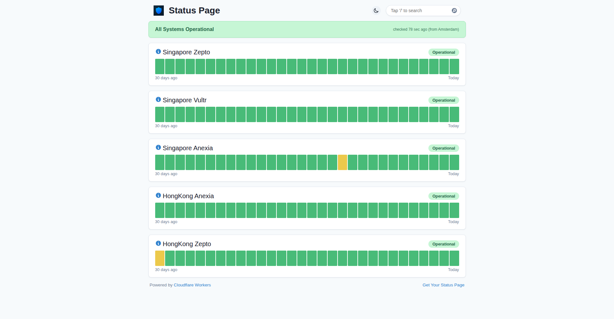

# Cloudflare Workers — Status Page

Monitor your websites/APIs, showcase status including daily history, and get
Slack / Telegram / Discord notifications whenever a status changes.
Powered by **Cloudflare Workers**, **Cron Triggers** and **KV storage** —
no servers, no frontend build step.



## What stayed the same (from v1)

- Checks run every 2 minutes via Cron Trigger; results are stored in KV
  under the same key (`monitors_data_v1_1`) — **history survives upgrades**.
- `config.yaml` is still the single source of truth for monitors and texts.
- Slack / Telegram / Discord notifications on status change.
- Stale data cleanup (monitors removed from config, days older than
  `daysInHistogram`) — previously a post-deploy script, now built into the Worker.
- MIT license.

## What changed in v2

- **Removed Flareact** (unmaintained since 2021, incompatible with modern
  wrangler) → dependency-free static frontend (plain HTML/CSS/JS).
- **Worker rewritten** to modules format (`src/index.js`: `fetch` + `scheduled`).
- **wrangler v4** config: Workers Static Assets, `kv_namespaces`, cron triggers.
- **Deploy workflow rebuilt**: Node 22, wrangler CLI directly, KV namespace
  auto-created/reused via API; runs on push to `main` or manually.
- **Histogram → latency chart**: each monitor now shows a 30-day daily
  average response-time chart with red markers on incident days
  (hover for per-day details).
- **Monitor list refreshed**: NextDNS edge PoPs ordered by measured latency
  from Vietnam (13 monitors: VN, SG, HK, KL, Tokyo, Bangkok, Taipei).
- Dependencies updated; vulnerable `node-fetch`/`postcss` era packages gone.

## Deploy with GitHub Actions (recommended)

1. Fork/clone this repository.
2. **Settings → Secrets and variables → Actions**, add:
   - `CF_API_TOKEN` — token with `Edit Cloudflare Workers` permissions
   - `CF_ACCOUNT_ID` — your Cloudflare account ID
   - _(optional)_ `SECRET_SLACK_WEBHOOK_URL`
   - _(optional)_ `SECRET_TELEGRAM_API_TOKEN` + `SECRET_TELEGRAM_CHAT_ID`
   - _(optional)_ `SECRET_DISCORD_WEBHOOK_URL`
3. Edit [`config.yaml`](./config.yaml):

   ```yaml
   monitors:
     - id: my-site # unique identifier
       name: example.com
       description: 'My website' # tooltip, optional
       url: 'https://example.com/' # URL to fetch
       method: GET # default=GET
       expectStatus: 200 # default=200
       followRedirect: false # default=false
       linkable: true # title as link, default=true
   ```

4. Push to `main` (or run the **Deploy** workflow manually).
5. _(optional)_ Assign a custom domain in the
   [Cloudflare dashboard](https://dash.cloudflare.com/?to=/workers).

## Telegram notifications

1. [Create a bot](https://core.telegram.org/bots#creating-a-new-bot) →
   `SECRET_TELEGRAM_API_TOKEN`.
2. Send any message to the bot.
3. `curl https://api.telegram.org/bot<TOKEN>/getUpdates` →
   `.result[0].message.chat.id` → `SECRET_TELEGRAM_CHAT_ID`.
4. Redeploy.

## Run locally

Requirements: Node 22+, a Cloudflare account.

```bash
npm install
npm run dev        # builds config, starts wrangler dev with local KV
```

Open http://localhost:8787. Trigger a check manually:
`curl http://localhost:8787/api/trigger`.

## Deploy manually (without GitHub Actions)

```bash
npm install
wrangler login
wrangler kv namespace create KV_STATUS_PAGE   # copy the id into wrangler.toml
wrangler secret put SECRET_SLACK_WEBHOOK_URL  # repeat for other secrets (optional)
npm run deploy
```

## Notes

- Upgrading from v1: the KV key is unchanged, so deploying v2 over an
  existing namespace keeps all history. Do not mix old and new files.
- Free plan: KV quota covers the default 2-minute interval; change `crons`
  in `wrangler.toml` to check less often.
- Max ~25 monitors with Slack notifications (Cloudflare subrequest limit).

## Credits

- Original project: [eidam/cf-workers-status-page](https://github.com/eidam/cf-workers-status-page)
  (via [yue374/cf-workers-status-page](https://github.com/yue374/cf-workers-status-page),
  which this repository was forked from). The git history was restarted in
  October 2026 from the full rewrite, but the idea and the early work belong
  to the upstream authors — thank you.
- UI/UX design language inspired by [lyc8503/UptimeFlare](https://github.com/lyc8503/UptimeFlare).

## License

MIT — see [LICENSE](./LICENSE).
